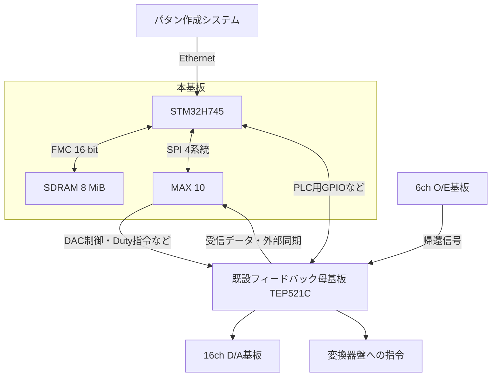

# J-PARC MR 主電磁石電源フィードバック制御子基板

J-PARC メインリング（MR）の主電磁石電源で、電流パタンに沿って電磁石電流を制御するための子基板です。既設のフィードバック母基板 **TEP521C** を使い、その上の **HUMANDATA ACM-205** を、STM32H745 と MAX 10 を搭載した本基板に置き換えます。

既設の光受信、D/A 出力、PLC、変換器盤への Duty 指令は母基板のコネクタを通ります。新たに Ethernet と SDRAM を子基板に持たせ、これまで独立したパタンメモリ基板が担っていた電流指令の受信・保持を取り込むことが設計の狙いです。

## 設計を読む

| 知りたいこと | 資料 |
| --- | --- |
| 回路全体と部品の接続 | [回路図 PDF 全6ページ](docs/drawings/schematic.pdf) |
| 基板の配線と両面の部品配置 | [配線・配置図 PDF 全10ページ](docs/drawings/pcb-patterns.pdf) |
| 回路図・PCB の編集 | [KiCad プロジェクト](hardware/kicad/JPARC_PS_FB_BOARD.kicad_pro) |
| プロセッサの役割、電源、メモリ、クロック | [ハードウェア構成](docs/hardware.md) |
| 母基板との対応、ADC/DAC の接点と FPGA ボール | [外部インターフェース](docs/interfaces.md) |
| ランド単位のネット名、部品座標 | [ピン・ネット対応 CSV](hardware/tables/pin-net-mapping.csv) · [部品配置 CSV](hardware/tables/component-locations.csv) |
| 8層基板の製造条件・実装用ペースト | [製造・実装資料](manufacturing/README.md) |
| 接続・DRC の検査結果と原本の識別 | [設計検証記録](verification/README.md) |

このリポジトリの対象は子基板のハードウェアです。MCU の制御ソフトウェア、MAX 10 の動作用 HDL、閉ループでの追従性能・遅延・ジッタの実測値は収録していません。図は設計上の信号経路を示します。
